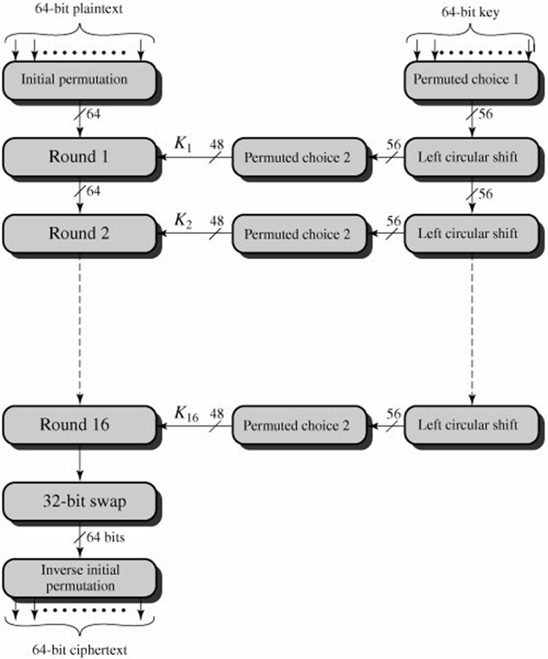
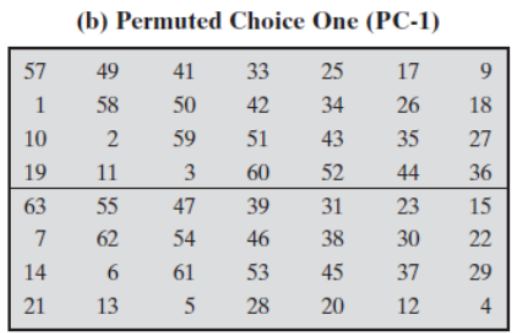
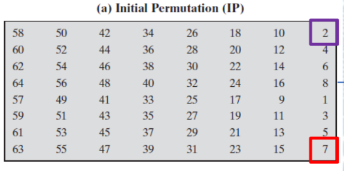
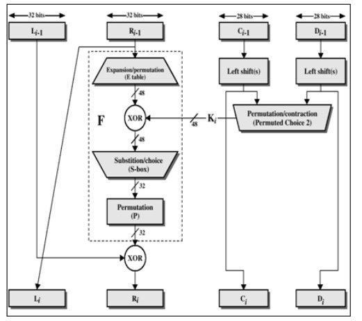
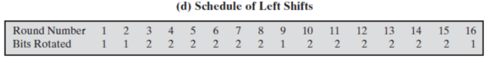
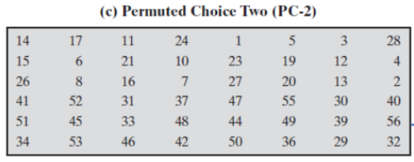
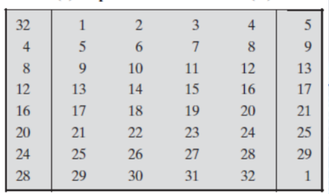
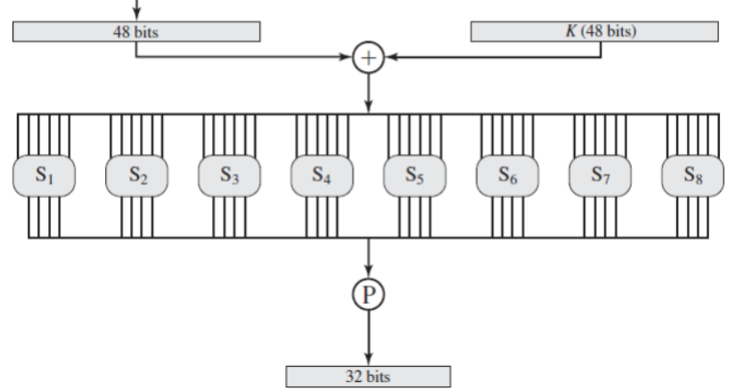
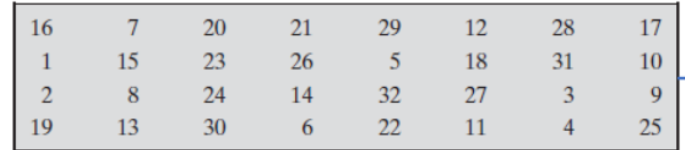
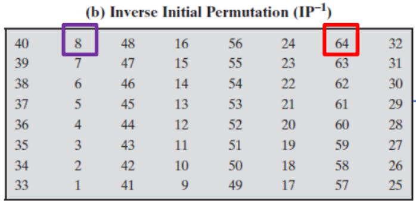

# DES Lab

## Objective:
The primary goal of this lab is to provide hands-on experience with the 
Data Encryption Standard (DES), a classic symmetric-key block cipher. 

You will implement DES step-by-step to understand its underlying principles and 
operations at the bit level.

## Learning Outcomes:
Upon completing this lab, you will be able to:
- Understand the Feistel network structure and the role of rounds in block ciphers.
- Implement key scheduling, including PC-1, PC-2 permutations and circular shifts.
- Implement the expansion function, S-box substitutions, and P-permutation.
- Combine all components to perform full 16-round DES encryption.

## Algorithm:

DES encryption consists of a sequence of permutations and substitutions applied over 16 rounds.

### 1. Permuted Choice 1 (PC-1)

- Takes a 64-bit key as input.

- Discards every 8th bit (parity bits).

- Produces a 56-bit key.

  

### 2. Initial Permutation (IP)

- Takes the 64-bit plaintext as input.

- Rearranges the bit positions according to the IP table.

- Example: The first output bit is taken from position 58 of the plaintext.

  

### 3. Splitting
- Split the permuted plaintext into two equal halves at the begining of each round:

  - Left half (L0) → 32 bits

  - Right half (R0) → 32 bits
  
  

### 4. Permuted Choice 2 (PC-2) – Round Key Generation
From the 56-bit key:

- Split the key

  - Left half C (28 bits)

  - Right half D (28 bits)

- Circular Left Shifts

  - Rotate C and D left by 1 or 2 bits depending on the round.
 
  

- Compression Permutation

  - Select and permute 48 bits from the combined C and D halves using PC-2.

  

### 5. Expansion Permutation (E)

- Expand the 32-bit right half to 48 bits using the expansion table.

  
### 6. XOR Operation

- XOR the expanded right half with the 48-bit round key.

### 7. Substitution (S-Boxes)

- Divide the 48-bit result into eight blocks of 6 bits.

- Each block is processed by one S-box (4 rows × 16 columns).

- Steps for each 6-bit block:

  - First and last bits → row number

  - Middle four bits → column number

  - Lookup value in S-box

  - Convert the decimal value to 4-bit binary

  - Result: 32-bit output.

  

### 8. Straight Permutation (P)

- Permute the 32-bit S-box output using the P-permutation table.
  

### 9. Final XOR and Swap

- XOR the permuted result with the left half.

- Swap left and right halves.

- Repeat steps 5–9 for 16 rounds.

### 10. Final Permutation (IP⁻¹)

- After round 16, swap halves.

- Apply the inverse initial permutation to obtain the ciphertext.

  
